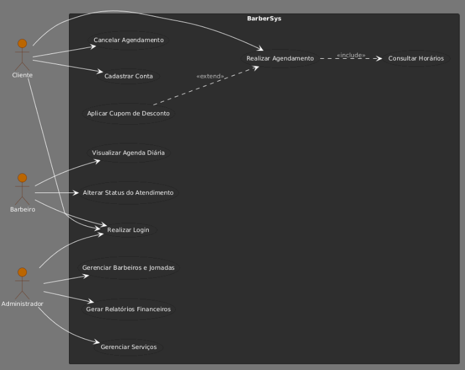
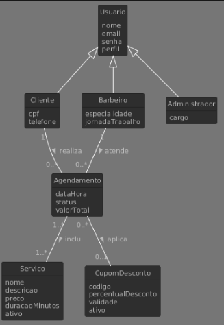
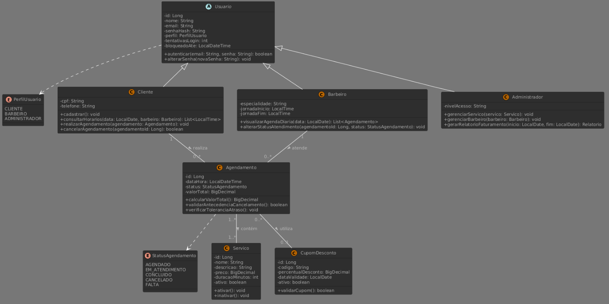

# Documentação do Projeto — BarberSys

## 1. Fase de Análise

### 1.1. Requisitos Funcionais (RF)
- **RF01 (Cadastro e Autenticação):** O sistema deve permitir o cadastro de clientes (solicitando nome completo, e-mail, telefone/WhatsApp, CPF e senha) e a autenticação (login) de clientes, barbeiros e administradores mediante e-mail e senha.
- **RF02:** O sistema deve permitir que o cliente consulte os horários disponíveis por barbeiro e por serviço.
- **RF03:** O sistema deve permitir que o cliente realize o agendamento de um ou mais serviços.
- **RF04:** O sistema deve permitir que o cliente cancele ou remarque um agendamento com antecedência.
- **RF05:** O sistema deve permitir que o administrador gerencie (cadastrar, editar, inativar) o catálogo de serviços, incluindo nome, preço e duração.
- **RF06:** O sistema deve permitir que o administrador gerencie os perfis e jornadas de trabalho dos barbeiros.
- **RF07:** O sistema deve permitir que o barbeiro visualize a sua agenda diária e semanal de atendimentos.
- **RF08:** O sistema deve permitir que o barbeiro altere o status do agendamento (ex.: "Em atendimento", "Concluído", "Falta").
- **RF09:** O sistema deve manter o histórico de atendimentos e serviços realizados por cada cliente.
- **RF10:** O sistema deve gerar relatórios operacionais de atendimentos realizados e faturamento por período.

### 1.2. Requisitos Não Funcionais (RNF)
- **RNF01 (Usabilidade):** O sistema deve possuir uma interface responsiva, adaptada para navegação em dispositivos móveis e computadores.
- **RNF02 (Desempenho):** A consulta de disponibilidade de horários deve responder em menos de 2 segundos.
- **RNF03 (Segurança):** As senhas de todos os utilizadores devem ser armazenadas de forma criptografada na base de dados.
- **RNF04 (Disponibilidade):** O sistema deve estar disponível para agendamentos online 24 horas por dia, 7 dias por semana.
- **RNF05 (Manutenibilidade):** O sistema deve ser desenvolvido com arquitetura em camadas para facilitar futuras expansões e manutenções.

### 1.3. Regras de Negócio (RN)
- **RN01 (Cancelamento):** O cancelamento de um agendamento sem taxa de penalidade só pode ser efetuado pelo cliente com no mínimo 2 horas de antecedência em relação ao horário marcado.
- **RN02 (Sobreposição de Horários):** O sistema não deve permitir dois agendamentos no mesmo horário para o mesmo barbeiro.
- **RN03 (Tolerância de Atraso):** Se o cliente não comparecer até 15 minutos após o horário agendado, o status do atendimento muda automaticamente para "Falta".
- **RN04 (Critérios de Cadastro):** Para realizar o autocadastro como cliente, é obrigatório informar nome completo, e-mail válido e único, telefone (WhatsApp), CPF válido e senha com no mínimo 8 caracteres (contendo letras e números). O cadastro de novos barbeiros e administradores não é público, sendo efetuado exclusivamente pelo Administrador.
- **RN05 (Autenticação e Login):** O acesso (login) ao sistema exige e-mail cadastrado e senha. Após 5 tentativas consecutivas de login com senha incorreta, a conta é temporariamente bloqueada por 15 minutos por segurança.

### 1.4. Diagrama de Casos de Uso

*Descrição do Diagrama:* O diagrama ilustra as interações dos atores **Cliente**, **Barbeiro** e **Administrador** com o sistema **BarberSys**. Contempla o fluxo de cadastro do cliente e autenticação dos três perfis, as operações de agendamento do cliente (com inclusão obrigatória de consulta de horários e extensão opcional de cupom), o controle de agenda pelo barbeiro e as funções administrativas de gestão de serviços, barbeiros e relatórios.

---

## 2. Documentação dos Casos de Uso

### UC00: Cadastrar Conta e Realizar Login
* **Caso de Uso:** UC00 — Cadastrar Conta e Realizar Login
* **Ator Principal:** Cliente (Cadastro e Login), Barbeiro (Login), Administrador (Login)
* **Resumo:** Permite o autocadastro de novos clientes e a autenticação de todos os perfis de utilizadores no sistema.
* **Pré-condições:** O utilizador deve aceder à página inicial do sistema.
* **Pós-condições:** O cliente tem a conta registada na base de dados e/ou o utilizador acede ao painel correspondente ao seu perfil.

#### FLUXO PRINCIPAL (Cadastro de Cliente)
1. O cliente seleciona a opção "Criar Conta".
2. O sistema solicita nome completo, e-mail, telefone (WhatsApp), CPF e senha.
3. O cliente preenche os dados e confirma.
4. O sistema valida o formato dos dados, a unicidade do e-mail/CPF e os requisitos mínimos da senha (**RN04**).
5. O sistema cria o registo com perfil "Cliente" e confirma o cadastro.

#### FLUXO ALTERNATIVO
* **FA01 — Realizar Login:**
  * **1a.** O utilizador (Cliente, Barbeiro ou Administrador) informa e-mail e senha na tela de login.
  * **1b.** O sistema valida as credenciais (**RN05**).
  * **1c.** O sistema redireciona o utilizador para o painel específico do seu perfil.

#### FLUXOS DE EXCEÇÃO
* **FE01 — Dados Inválidos ou Já Cadastrados:**
  * **4a.** O sistema identifica que o e-mail ou CPF já existem ou que a senha não cumpre a **RN04**.
  * **4b.** O sistema exibe mensagem informando o campo inválido e solicita correção.
* **FE02 — Falha de Autenticação e Bloqueio (RN05):**
  * **1b.1.** O utilizador insere e-mail ou senha incorretos.
  * **1b.2.** O sistema exibe mensagem de credenciais inválidas. Caso atinja 5 tentativas seguidas, bloqueia o acesso por 15 minutos.

---

### UC05: Gerenciar Serviços e Barbeiros (Administrador)
* **Caso de Uso:** UC05 — Gerenciar Serviços e Barbeiros
* **Ator Principal:** Administrador
* **Resumo:** Permite ao administrador cadastrar, editar ou inativar serviços oferecidos pela barbearia, bem como cadastrar barbeiros e definir as suas jornadas de trabalho.
* **Pré-condições:** O administrador deve estar autenticado no sistema.
* **Pós-condições:** O catálogo de serviços e/ou as escalas de horários dos barbeiros são atualizados e disponibilizados para agendamento.

#### FLUXO PRINCIPAL
1. O administrador acede ao painel administrativo e seleciona "Gerenciar Serviços" ou "Gerenciar Barbeiros".
2. O sistema exibe a lista atual de registos cadastrados.
3. O administrador opta por cadastrar um novo item ou editar/inativar um existente (informando nome, preço e duração para serviços; ou nome, e-mail, senha inicial e dias/horários de atendimento para barbeiros).
4. O administrador guarda as alterações.
5. O sistema valida os dados e atualiza a base de dados.

   ---

## 3. Diagrama de Classes

### 3.1. Modelo Conceitual

*Descrição do Modelo Conceitual:* Apresenta as entidades centrais do domínio do **BarberSys** e suas regras estruturais. A classe base **Usuario** generaliza os três perfis do sistema (**Cliente**, **Barbeiro** e **Administrador**). Um **Cliente** realiza zero ou vários **Agendamentos**, cada qual vinculado a um **Barbeiro**, contendo um ou mais **Serviços** e podendo aplicar opcionalmente um **CupomDesconto**.

### 3.2. Modelo de Domínio (Especificação)

*Descrição do Modelo de Domínio:* Detalha a estrutura orientada a objetos para implementação, definindo visibilidade de atributos (`-` privado, `+` público), tipagem forte, enumerações (`PerfilUsuario` e `StatusAgendamento`) e métodos que encapsulam as regras de negócio — como `autenticar()`, `validarAntecedenciaCancelamento()` (RN01) e `verificarToleranciaAtraso()` (RN03).
