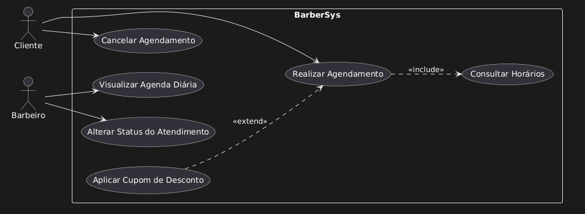

# Documentação do Projeto — BarberSys

## 1. Fase de Análise

### 1.1. Requisitos Funcionais (RF)
- **RF01:** O sistema deve permitir o cadastro e login de clientes, barbeiros e administradores.
- **RF02:** O sistema deve permitir que o cliente consulte os horários disponíveis por barbeiro e por serviço.
- **RF03:** O sistema deve permitir que o cliente realize o agendamento de um ou mais serviços.
- **RF04:** O sistema deve permitir que o cliente cancele ou remarque um agendamento com antecedência.
- **RF05:** O sistema deve permitir que o administrador gerencie (cadastrar, editar, inativar) o catálogo de serviços, incluindo nome, preço e duração.
- **RF06:** O sistema deve permitir que o administrador gerencie os perfis e jornadas de trabalho dos barbeiros.
- **RF07:** O sistema deve permitir que o barbeiro visualize a sua agenda diária e semanal de atendimentos.
- **RF08:** O sistema deve permitir que o barbeiro altere o status do agendamento (ex.: "Em atendimento", "Concluído", "Falta").
- **RF09:** O sistema deve manter o histórico de atendimentos e serviços realizados por cada cliente.
- **RF10:** O sistema deve gerar relatórios operacionais de atendimentos realizados e faturamento por período.

### 1.2. Requisitos Não Funcionais (RNF)
- **RNF01 (Usabilidade):** O sistema deve possuir uma interface responsiva, adaptada para navegação em dispositivos móveis e computadores.
- **RNF02 (Desempenho):** A consulta de disponibilidade de horários deve responder em menos de 2 segundos.
- **RNF03 (Segurança):** As senhas de todos os utilizadores devem ser armazenadas de forma criptografada na base de dados.
- **RNF04 (Disponibilidade):** O sistema deve estar disponível para agendamentos online 24 horas por dia, 7 dias por semana.
- **RNF05 (Manutenibilidade):** O sistema deve ser desenvolvido com arquitetura em camadas para facilitar futuras expansões e manutenções.

### 1.3. Regras de Negócio (RN)
- **RN01 (Cancelamento):** O cancelamento de um agendamento sem taxa de penalidade só pode ser efetuado pelo cliente com no mínimo 2 horas de antecedência em relação ao horário marcado.
- **RN02 (Sobreposição de Horários):** O sistema não deve permitir dois agendamentos no mesmo horário para o mesmo barbeiro.
- **RN03 (Tolerância de Atraso):** Se o cliente não comparecer até 15 minutos após o horário agendado, o status do atendimento muda automaticamente para "Falta".

### 1.4. Diagrama de Casos de Uso

*Descrição do Diagrama:* O diagrama ilustra as interações dos atores **Cliente** e **Barbeiro** com o sistema **BarberSys**. O caso de uso *Realizar Agendamento* exige obrigatoriamente a execução de *Consultar Horários* (`<<include>>`), enquanto a funcionalidade *Aplicar Cupom de Desconto* estende a funcionalidade de agendamento de forma condicional (`<<extend>>`).

---

## 2. Documentação dos Casos de Uso

### UC01: Realizar Agendamento
* **Caso de Uso:** UC01 — Realizar Agendamento
* **Ator Principal:** Cliente
* **Resumo:** Permite que o cliente selecione o barbeiro, o serviço desejado e a data/horário para efetuar uma reserva de atendimento na barbearia.
* **Pré-condições:** O cliente deve estar autenticado e deve existir pelo menos um barbeiro disponível.
* **Pós-condições:** O agendamento é registado com status "Agendado".

#### FLUXO PRINCIPAL
1. O cliente escolhe a opção "Novo Agendamento".
2. O sistema executa o caso de uso **UC02 — Consultar Horários** (`<<include>>`).
3. O cliente seleciona o barbeiro, serviço, data e horário disponível.
4. O cliente confirma a reserva.
5. O sistema valida as informações e regista o agendamento.
6. O sistema exibe a mensagem de confirmação.

#### FLUXOS ALTERNATIVOS
* **FA01 — Aplicar Cupom de Desconto (`<<extend>>`):**
  * **2a.** No passo 4 do Fluxo Principal, o cliente insere um código de cupom válido.
  * **2b.** O sistema valida o cupom e recalcula o valor total com desconto.

#### FLUXOS DE EXCEÇÃO
* **FE01 — Indisponibilidade de Horário:**
  * **3a.** O horário escolhido é ocupado por outro utilizador antes da confirmação.
  * **3b.** O sistema informa o erro e solicita nova seleção.

---

### UC02: Consultar Horários
* **Caso de Uso:** UC02 — Consultar Horários
* **Ator Principal:** Cliente
* **Resumo:** Pesquisa e exibe as datas e horários disponíveis na agenda dos barbeiros.
* **Pré-condições:** Jornada de trabalho dos barbeiros cadastrada.
* **Pós-condições:** Exibição da grelha de horários livres.

#### FLUXO PRINCIPAL
1. O sistema solicita os critérios de busca.
2. O cliente seleciona a data e/ou barbeiro pretendido.
3. O sistema pesquisa os horários sem marcação.
4. O sistema exibe a lista de horários disponíveis.

---

### UC03: Cancelar Agendamento
* **Caso de Uso:** UC03 — Cancelar Agendamento
* **Ator Principal:** Cliente
* **Resumo:** Permite ao cliente cancelar um agendamento efetuado previamente.
* **Pré-condições:** Cliente autenticado com agendamento ativo.
* **Pós-condições:** Status alterado para "Cancelado" e horário libertado.

#### FLUXO PRINCIPAL
1. O cliente acede a "Meus Agendamentos".
2. O cliente seleciona o agendamento e clica em "Cancelar".
3. O sistema valida a regra de antecedência (**RN01**).
4. O cliente confirma a operação.
5. O sistema cancela a reserva e libera a agenda.

#### FLUXOS DE EXCEÇÃO
* **FE01 — Cancelamento Fora do Prazo (RN01):**
  * **3a.** Pedido feito com menos de 2h de antecedência.
  * **3b.** O sistema bloqueia a ação e indica contacto telefónico.

---

### UC04: Visualizar Agenda Diária
* **Caso de Uso:** UC04 — Visualizar Agenda Diária
* **Ator Principal:** Barbeiro
* **Resumo:** Permite ao barbeiro consultar a sua lista de atendimentos do dia.
* **Pré-condições:** Barbeiro autenticado.
* **Pós-condições:** Agenda do dia apresentada.

#### FLUXO PRINCIPAL
1. O barbeiro acede ao painel principal.
2. O sistema carrega e exibe os agendamentos do dia ordenados por horário.
